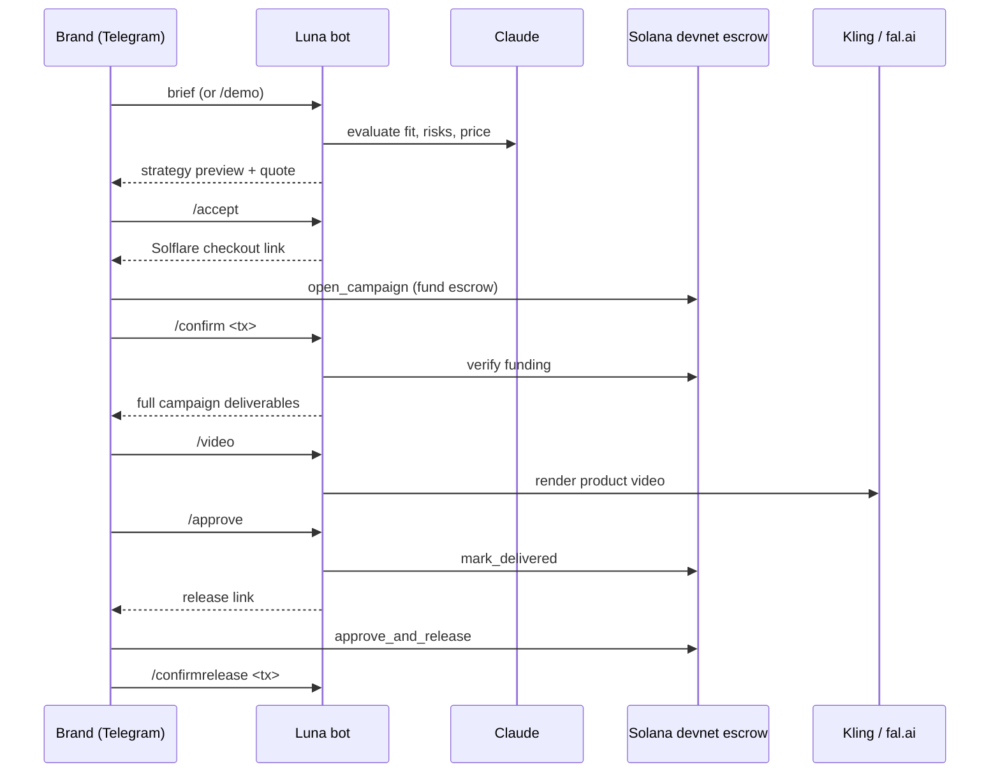

# CulturSync Luna

A Telegram bot that turns a brand's product brief into an escrow-backed UGC campaign: it evaluates and prices the job, takes payment into a Solana devnet escrow, then delivers hooks, captions, a shot list and an AI-rendered product video.

> **Naming:** *CulturSync* is the overall AI marketing product; *Luna* is the execution agent inside it that negotiates, handles escrow and delivers the creative. This repo is Luna, so the bot introduces itself as "CulturSync AI".


<!-- screenshot: add docs/screenshot.png -->

## Features

- **Chat-first intake** — send a product link, markets, budget and deliverables as a normal Telegram message.
- **Evaluates and prices** — Claude scores campaign fit, flags risks and quotes a price; you can counter with `/offer`.
- **Preview before payment** — the brand sees teaser hooks and strategy, not the full creative, until escrow is funded.
- **On-chain escrow** — an Anchor program on Solana devnet holds the funds; they're released only after the brand approves.
- **Full deliverables** — hooks, captions, shot list, voiceover, creator direction, image and video prompts.
- **AI video** — optional silent TikTok-style product video via Kling (official API or fal.ai).

## How it works



In short: **Brief → Escrow → Campaign + Video → Brand approval → Payout.** If `ESCROW_PROGRAM_ID` and `PUBLIC_BASE_URL` aren't set, the bot falls back to a plain Solana Pay transfer to `LUNA_WALLET_ADDRESS` instead of the escrow program.

## Quickstart

Needs Node.js, a Telegram bot token from [@BotFather](https://t.me/BotFather), an Anthropic API key and a Solana devnet address.

```bash
git clone https://github.com/0jz/luna.git
cd luna
npm install
cp .env.example .env      # set TELEGRAM_BOT_TOKEN, ANTHROPIC_API_KEY, LUNA_WALLET_ADDRESS
npm run build
npm start
```

Then message your bot `/start` and `/demo`.

**For the Solflare escrow checkout**, the bot's HTTP server (port `3001`) must be reachable over HTTPS: expose it with ngrok or another tunnel and set `PUBLIC_BASE_URL` to the tunnel URL, plus `ESCROW_PROGRAM_ID`.

## Configuration

| Variable | Required | Default | Description |
|---|---|---|---|
| `TELEGRAM_BOT_TOKEN` | Yes | — | Bot token from BotFather. |
| `ANTHROPIC_API_KEY` | Yes | — | Anthropic API key. |
| `LUNA_WALLET_ADDRESS` | Yes | — | Luna's Solana address (creator / payee). |
| `ANTHROPIC_MODEL` | No | `claude-sonnet-4-5-20250929` | Claude model id. |
| `SOLANA_RPC_URL` | No | `https://api.devnet.solana.com` | Solana RPC. |
| `REVIEW_FEE_SOL` | No | `0.01` | Review fee for briefs sent with `/brief`. |
| `ESCROW_SOL` | No | `0.05` | Amount locked in escrow per campaign. |
| `ESCROW_PROGRAM_ID` | For escrow | — | Deployed `luna_escrow` program id (devnet: `3rqUcLXu1AwuCKNcjYMtqFiw8t94zUkVhn42PftWJen4` per `Anchor.toml`). |
| `PUBLIC_BASE_URL` | For escrow | — | Public HTTPS URL of the bot's server (serves `/pay`, `/release`). |
| `TRANSACTION_REQUEST_PORT` | No | `3001` | Port for the checkout/release server. |
| `LUNA_CREATOR_KEYPAIR_PATH` | For on-chain delivery | — | JSON keypair for `LUNA_WALLET_ADDRESS`; needed to sign `mark_delivered`. **Secret.** |
| `KLING_ACCESS_KEY` / `KLING_SECRET_KEY` | For video (option A) | — | Official Kling API credentials (preferred if set). |
| `KLING_BASE_URL` | No | `https://api.klingai.com` | Kling API base URL. |
| `KLING_MODEL_NAME` | No | `kling-v2-6` | Kling model. |
| `KLING_MODE` | No | `pro` | `pro` or `std`. |
| `KLING_ENABLE_AUDIO` | No | `false` | `true` to request audio. |
| `KLING_DURATION_SECONDS` | No | `5` | Video length. |
| `FAL_KEY` | For video (option B) | — | fal.ai key, used when Kling credentials aren't set. |
| `FAL_KLING_TEXT_ENDPOINT` | No | fal Kling v2.6 pro text-to-video | fal.ai text-to-video endpoint. |
| `FAL_KLING_IMAGE_ENDPOINT` | No | fal Kling v2.6 pro image-to-video | fal.ai image-to-video endpoint. |
| `VIDEO_START_IMAGE_URL` | No | — | Optional start frame for image-to-video. |

## Usage

| Command | What it does |
|---|---|
| `/start` | Introduce the bot and show the brief format |
| `/demo` | Run the prepared demo brief (Merit Great Skin Instant Glow Serum, 1 reel) |
| *any text* | Treated as a campaign brief |
| `/brief <text>` | Paid-review path: brief + review fee (`REVIEW_FEE_SOL`) before the preview |
| `/offer <usd>` | Counter-offer during negotiation |
| `/accept` | Accept the quote and get escrow instructions |
| `/confirm <tx>` | Verify the escrow (or review-fee) transaction |
| `/deliver` | Re-send final deliverables (after escrow) |
| `/video` | Build a video brief and render it if Kling/fal is configured |
| `/approve` | Mark delivered on-chain and create the release link |
| `/confirmrelease <tx>` | Verify the escrow release |
| `/status` · `/debug` · `/test` | Campaign state · local debug state · connectivity check |

### Escrow program

The Anchor program in `programs/luna_escrow` exposes `open_campaign`, `mark_delivered`, `approve_and_release`, `refund_after_deadline` and `dispute`.

```bash
anchor build
anchor deploy --provider.cluster devnet
```

## Project structure

```text
src/index.ts                       The whole bot: Telegram commands, Claude prompts, video, checkout server
programs/luna_escrow/src/lib.rs    Anchor escrow program
Anchor.toml                        Program id + devnet provider config
project-proposal.md                Product proposal
merge-with-cultursync.md           How Luna fits into CulturSync
```

## Status & limitations

- **Devnet only**, paid in devnet SOL. Production would use USDC escrow.
- Campaign state is kept in memory per Telegram user and resets on restart.
- Escrow checkout needs a public HTTPS tunnel; without it the bot uses a simpler Solana Pay transfer.
- Video rendering needs Kling or fal.ai credentials.

## Roadmap

Built for a hackathon Marketing Agent track. Next step: after approval, let the brand connect a Meta ad account so Luna can launch the approved reel as a paid campaign, track performance and suggest the next creative test.

## License

No license file yet (`package.json` says `ISC`, but no license text is included).
